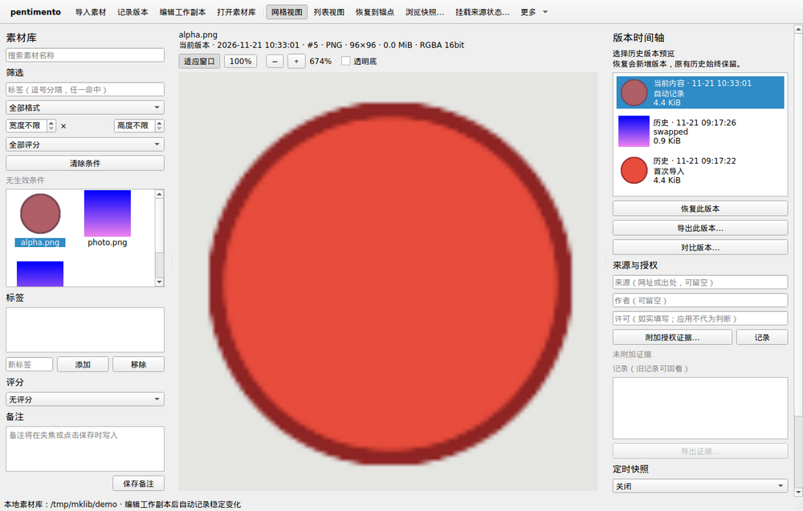
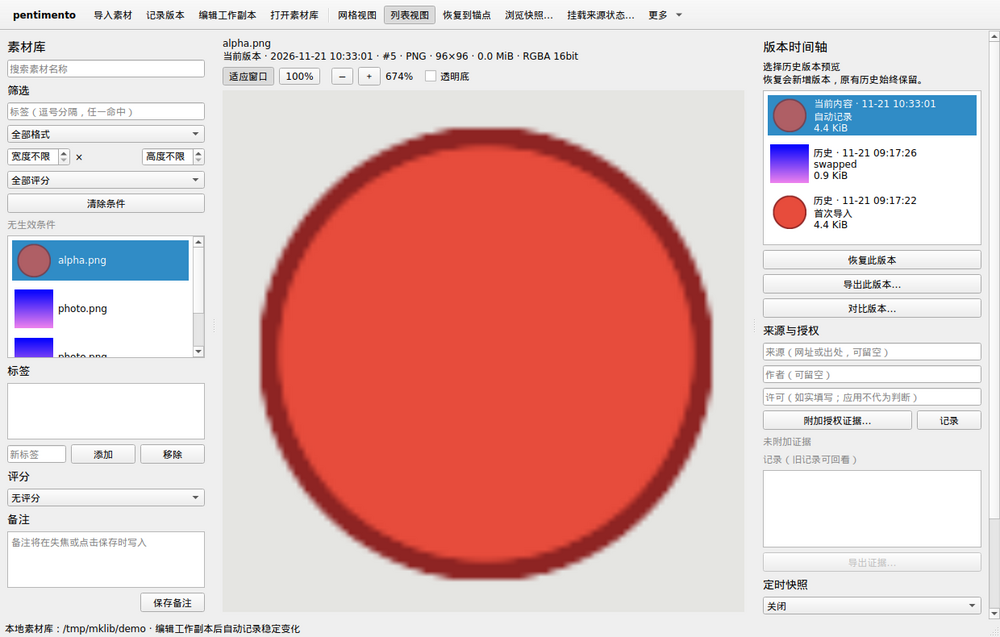
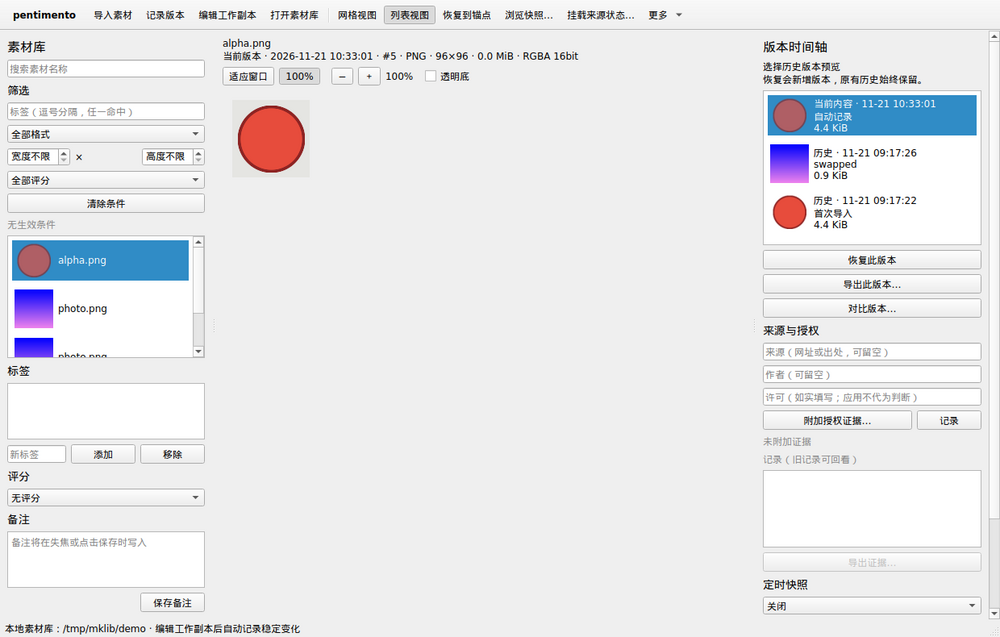
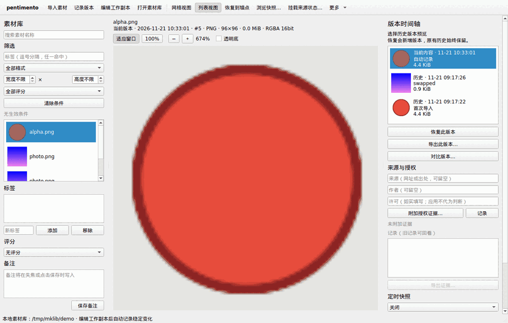
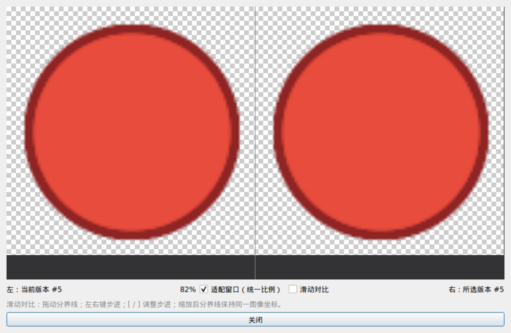
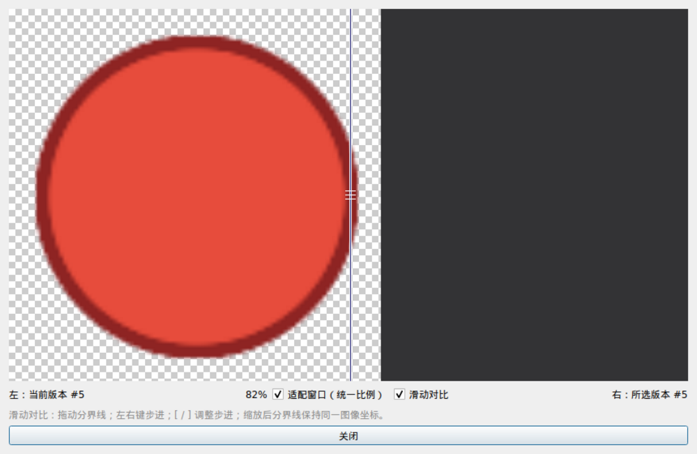
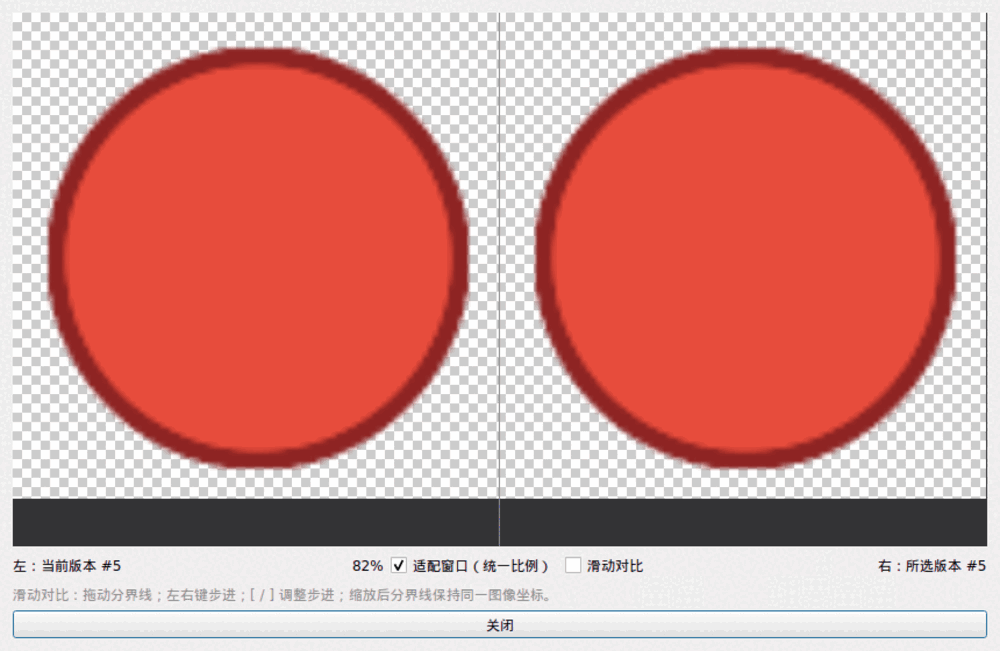

# Configuration effects

Every GUI toggle that has a visible effect, recorded as an off frame, an on frame and a looping GIF of the switch. Frames are real captures from the shipped build, taken on a real X server, so this page is also a regression check: rerunning the pipeline after a UI change reproduces them, and a toggle whose effect disappears is reported as a failure.

## Captured toggles

Each GIF is recorded as first state, switch, second state. First and second frames are also shipped as stills.

| Toggle | Where | First state | Second state |
| --- | --- | --- | --- |
| Transparent background (`透明底`) | Canvas toolbar | transparent pixels painted with the panel colour | transparent pixels painted as a checkerboard |
| View mode (`网格视图` / `列表视图`) | Main toolbar | one row per asset | grid of thumbnails |
| Zoom (`100%` / `适应窗口`) | Canvas toolbar | exact 100% | fitted to the canvas |
| Sliding compare (`滑动对比`) | Two-version compare dialog | two side-by-side panes | one pane with a draggable divider |

The compare dialog's `适配窗口（统一比例）` checkbox is deliberately outside this inventory: for square images, uniform-aspect scaling changes nothing on screen, so its off and on frames are identical and the 1% gate would report a false failure. It needs a non-square asset to have a visible effect, and faking one with a square fixture would be worse than omitting it.

## Transparent background

Off:


On:




## View mode

Off (one row per asset):


On (grid of thumbnails):




## Zoom

100%:


Fitted to the window:





## Sliding compare

Side by side:



Single pane with a divider:





## Regenerating the evidence

```sh
scripts/record-toggle-gifs.sh \
  --bin build/dev/pentimento \
  --library /path/to/a/library/with/two/versions \
  --out docs/assets/gifs
```

The script starts its own `Xvfb` when no display is reachable, pins the window to 1240x790, clicks each toggle, and measures every switch with `compare -metric AE`. A toggle whose off and on frames differ by less than 1% of the frame fails the run, which is what turns this page into a configuration-effect regression test. The captured coordinates are window-relative, which is why the window is resized and moved rather than assumed to be where a window manager put it.

Requirements: `xdotool`, `xwininfo`, `xwd`, ImageMagick (`convert`, `compare`), `Xvfb`.

The demo library only needs one asset with real transparency in its working copy and two recorded versions, so the compare dialog has history to show.
