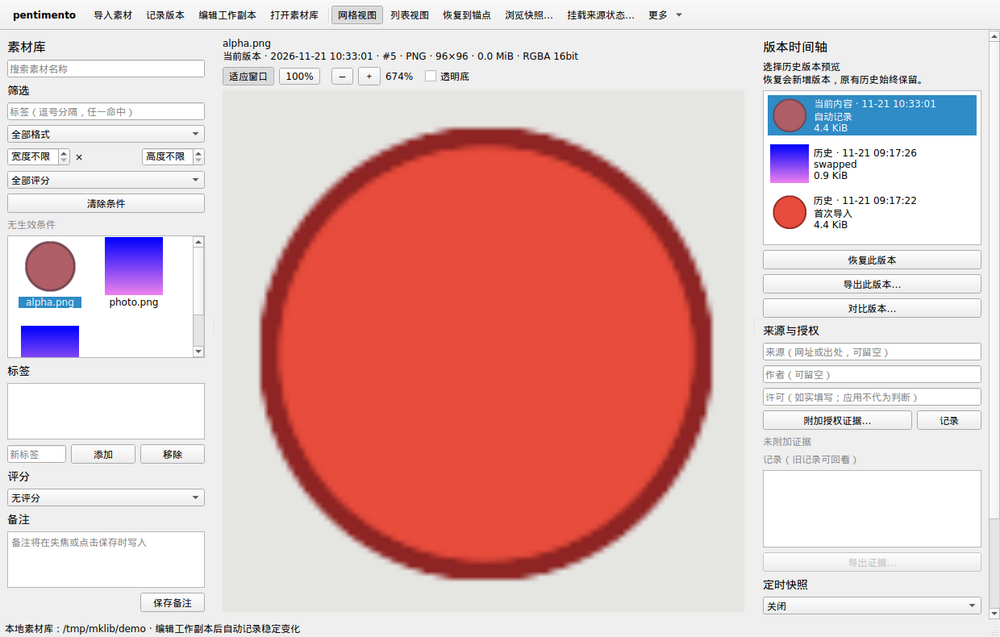
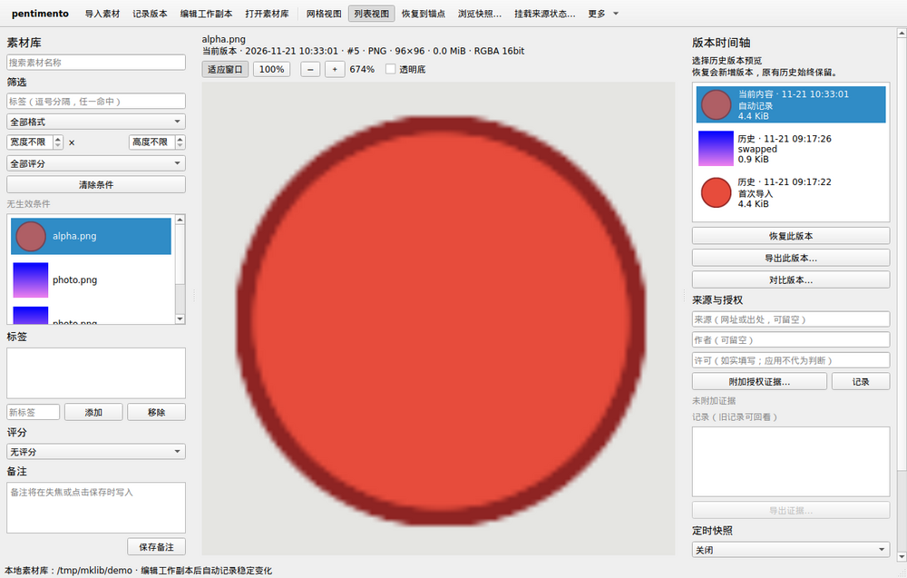
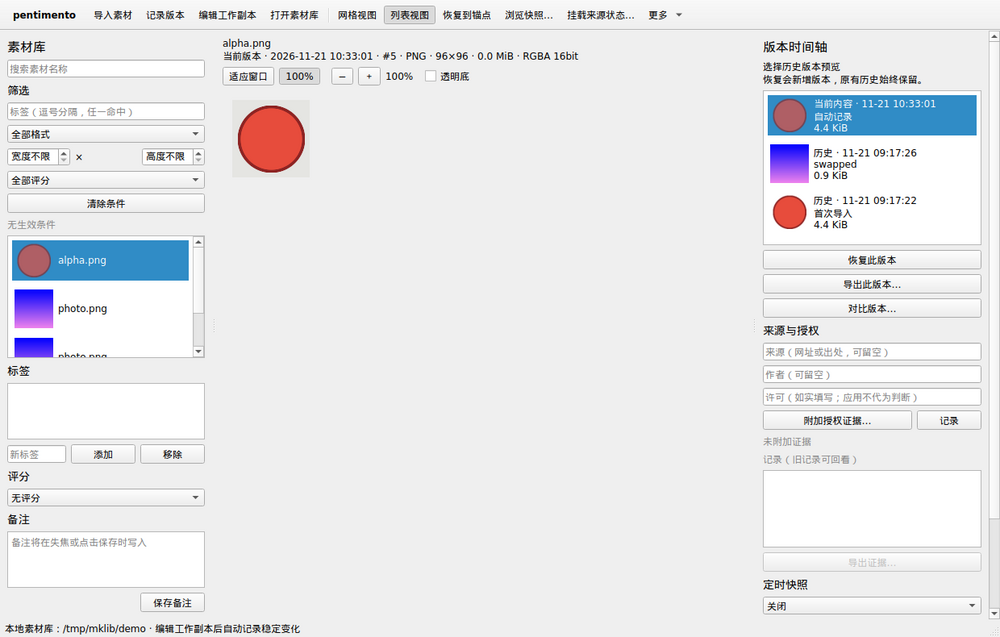
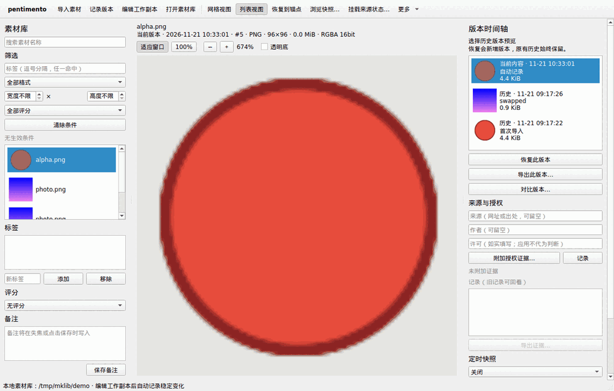
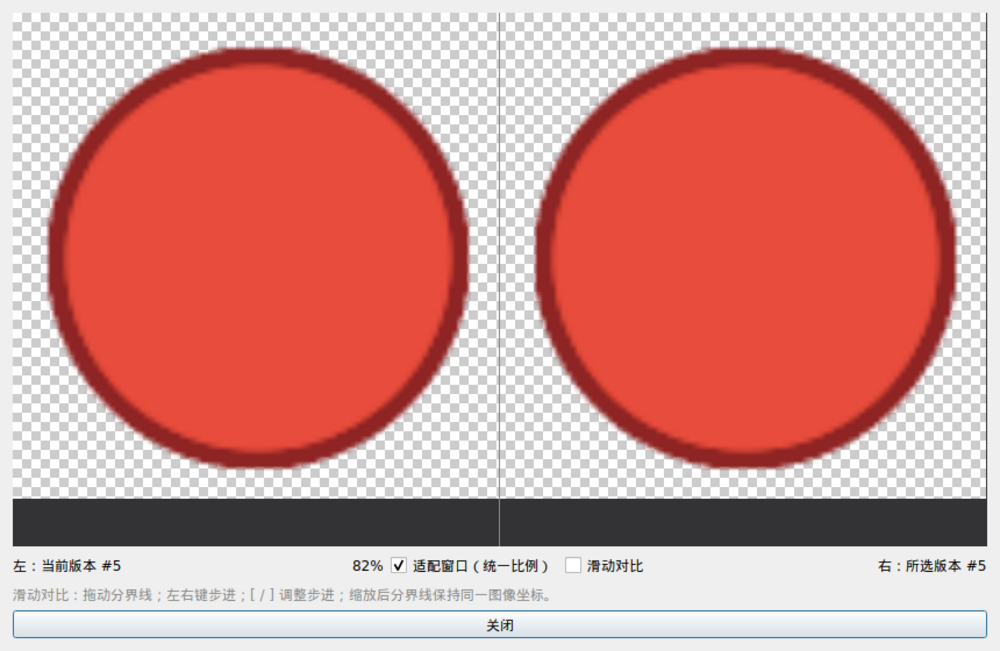
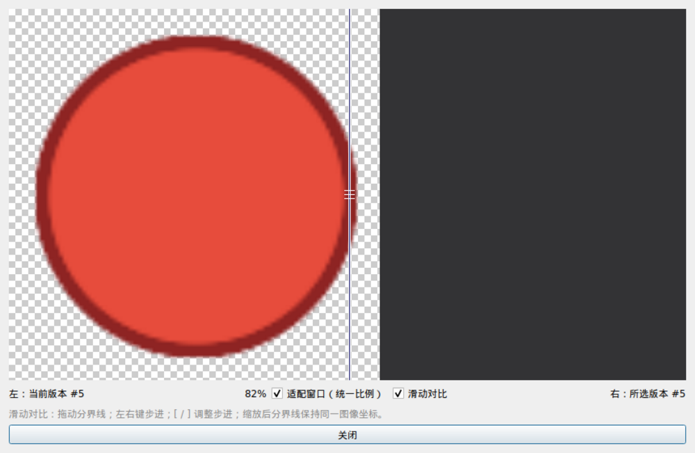
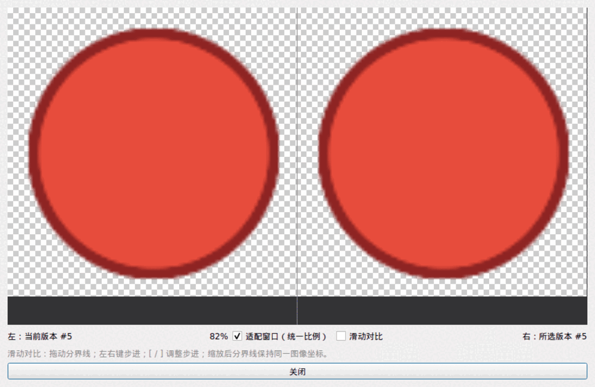

# 配置效果

所有「开启后有效果」的界面开关，逐项记录关闭态帧、开启态帧和切换过程的循环 GIF。帧取自真实 X 服务上的正式构建截图，因此本页同时是回归检查：UI 变更后重跑流水线即可复现，某个开关的效果消失会被报为失败。

## 已采集的开关

每个 GIF 按「第一状态 → 切换 → 第二状态」录制，两个状态也各自导出为静态图。

| 开关 | 位置 | 第一状态 | 第二状态 |
| --- | --- | --- | --- |
| 透明底 | 画布工具栏 | 透明像素按面板底色渲染 | 透明像素渲染为棋盘格 |
| 网格视图 / 列表视图 | 主工具栏 | 每个素材一行 | 缩略图网格 |
| 100% / 适应窗口 | 画布工具栏 | 精确 100% | 适应画布缩放 |
| 滑动对比 | 双版对比对话框 | 左右两栏并排 | 单栏加可拖动分界线 |

双版对比对话框里的「适配窗口（统一比例）」刻意不在本清单内：对正方形图像而言，统一比例缩放不产生任何可见变化，开关前后两帧完全相同，1% 门槛会误报失败。它需要非正方形素材才有可见效果，用正方形素材伪造证据不如直接说明。

## 透明底

关闭：


开启：




## 网格视图 / 列表视图

关闭（每个素材一行）：


开启（缩略图网格）：




## 缩放

100%：


适应窗口：





## 滑动对比

并排两栏：



单栏加分界线：





## 重新生成证据

```sh
scripts/record-toggle-gifs.sh \
  --bin build/dev/pentimento \
  --library /path/to/a/library/with/two/versions \
  --out docs/assets/gifs
```

脚本在检测不到显示服务器时自己启动 `Xvfb`，把窗口固定为 1240x790，逐个点击开关，并用 `compare -metric AE` 测量每次切换的像素差异。某个开关的开关闭态差异不足整帧 1% 时，运行以失败结束——这正是本页兼作配置效果回归测试的原因。脚本里的坐标是窗口相对坐标，所以必须显式调整窗口大小并移动到 0,0，而不是假定窗口管理器把它放在哪。

依赖：`xdotool`、`xwininfo`、`xwd`、ImageMagick（`convert`、`compare`）、`Xvfb`。

演示素材库只需一个素材：工作副本是有真实透明度的 PNG，且已有两个记录版本，这样双版对比才有历史可显示。
